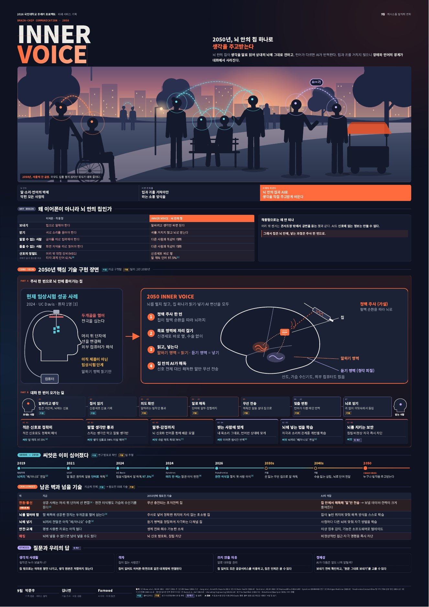

# INNER VOICE 포스터 소스

**2050년, 뇌 안의 칩 하나로 생각을 주고받는다** · 9팀

<a href="../INNER_VOICE_A0_v8.pdf"></a>

완성본: [`INNER_VOICE_A0_v8.pdf`](../INNER_VOICE_A0_v8.pdf)

## 포스터 규격

- 크기: A0 세로 841 × 1189 mm, 1페이지
- 해상도: 글자·도식은 벡터(확대해도 깨지지 않음), 배경 그라데이션 이미지는 300 dpi (기준 150 dpi 이상)
- 폰트: Noto Sans CJK KR, PDF에 포함

`render.py`는 PDF를 만든 뒤 페이지 수와 크기(841 × 1189 mm)를 자동으로 검사하고, 내용이 한 장을 넘치면 PDF를 만들지 않고 멈춥니다.

## 파일 구성

```
poster.html              포스터 원본 (HTML + CSS + 인라인 SVG 도식)
scene/scene.svg          2050년 공원 장면 그림
scene/make_scene.py      공원 장면 SVG 생성 스크립트
render.py                poster.html → A0 PDF 변환 + 규격 검사
INNER_VOICE_preview.jpg  README용 미리보기 이미지
```

## 다시 만들기

`poster/` 폴더 안에서 실행합니다.

```bash
pip install -r requirements.txt
playwright install chromium
python render.py poster.html output/INNER_VOICE_A0.pdf
```

공원 장면을 다시 그릴 때:

```bash
python scene/make_scene.py scene/scene.svg
```

한글이 똑같이 보이려면 컴퓨터에 **Noto Sans CJK KR** 폰트가 설치되어 있어야 합니다.

## 표기 규칙

포스터의 모든 주장에는 아래 라벨 중 하나가 붙어 있습니다.

- **사실**: 출처 원문으로 확인한 연구·발표
- **가설**: 연구의 연장선에서 팀이 그린 2050년
- **팀 제안**: 팀이 설계한 서비스 규칙

출처는 포스터 하단에 번호로 정리되어 있습니다.

## 역할

| 이름 | 역할 |
| --- | --- |
| 박준우 | 기획 총괄 · 서비스 설계 |
| 김나연 | 기술 조사 · 사실 검증 |
| Farnood | 시각화 · 미래 장면 |

자료 조사·문안·도식 초안에 Claude를 활용했고, 출처 원문으로 확인된 내용만 '사실'로 표기했습니다.
